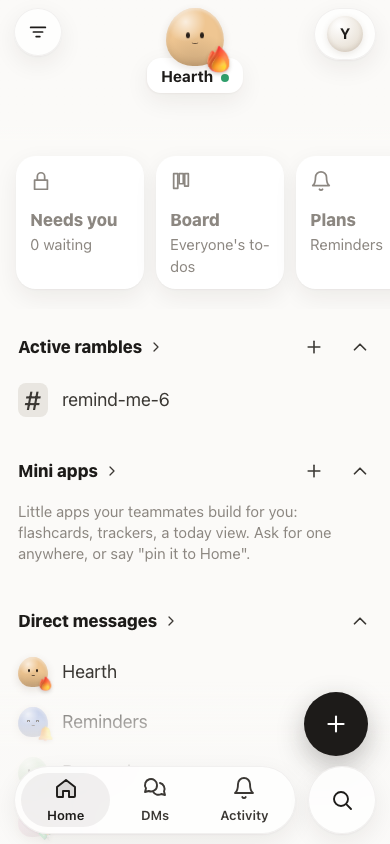
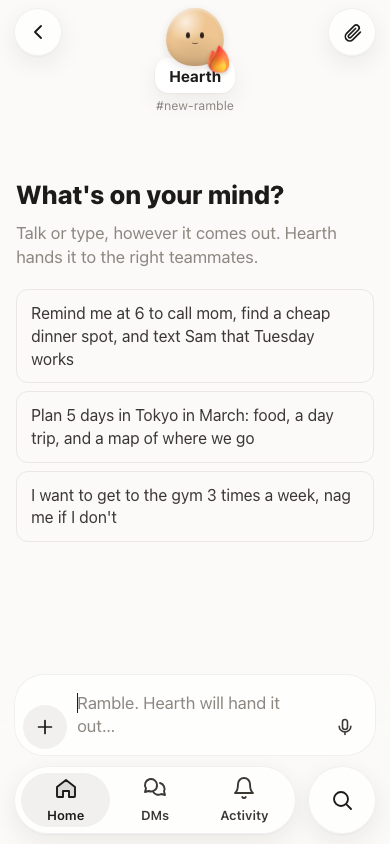
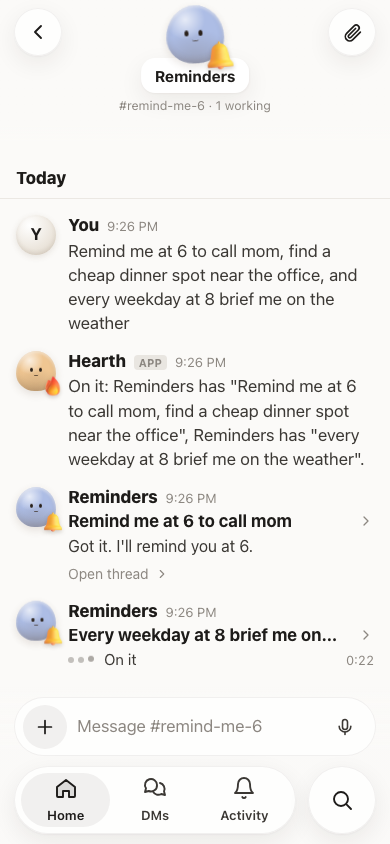
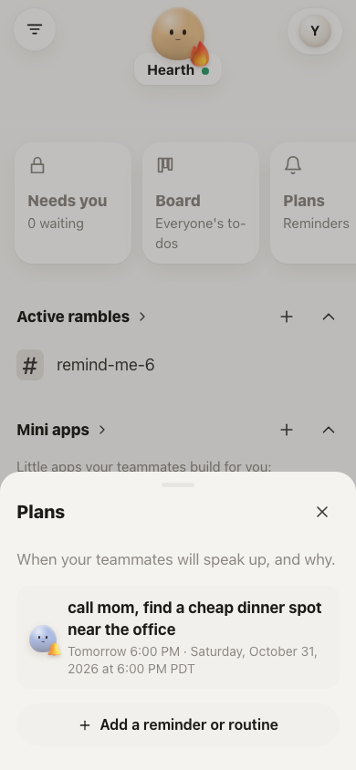
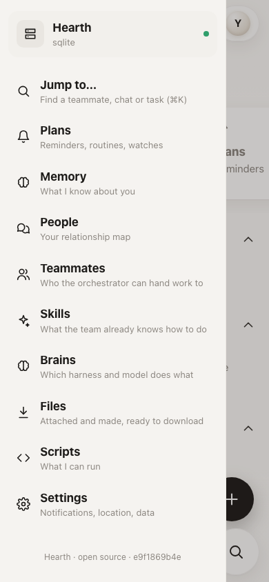

<p align="center"></p>

<h1 align="center">Hearth</h1>

<p align="center">
  <strong>A self-hosted, proactive personal assistant.</strong><br>
  Your data on your own server, the coding agent you already trust as its brain, and it texts you first when it matters.
</p>

<p align="center">
  <a href="LICENSE"></a>
  
  
  
</p>

<p align="center">
  <a href="#what-you-need">What you need</a> ·
  <a href="#quick-start">Quick start</a> ·
  <a href="#features">Features</a> ·
  <a href="#configuration">Configuration</a> ·
  <a href="docs/features.md">Docs</a> ·
  <a href="SECURITY.md">Security</a>
</p>

<table align="center">
  <tr>
    <td></td>
    <td></td>
    <td></td>
    <td></td>
    <td></td>
  </tr>
  <tr align="center">
    <td>Home</td><td>Ramble</td><td>Teammates at work</td><td>Plans</td><td>Everything else</td>
  </tr>
</table>

---

## Why Hearth?

**Think of it as Muse, but open source, and you own the data and the memory.**

Most assistants keep your life on someone else's servers and only answer when you ask. Hearth runs on a box you own and lives at an address you own, like `https://yournameassistant.com`. It uses `claude -p`, `codex exec` or any CLI you choose to do the thinking, and it speaks first when you've told it what matters: reminders, check-ins, a page that changed, a bill that's due.

Everything it learns about you sits in a database on your server. You can read it, edit it, export it as one file or wipe it. There's no relay, no account and no middleman: your phone talks straight to your hub over HTTPS.

## What you need

| | What | Cost |
|---|---|---|
| **A server** | Anything always on that runs Linux or macOS: a small VPS (AWS Lightsail, Hetzner, DigitalOcean), a home server or a spare Mac. Your laptop works for trying it out, but reminders only fire while it's awake. | about $5/month |
| **A domain** | So you can open it from anywhere at something like `https://yournameassistant.com`. Any registrar works; HTTPS certificates are automatic and free. | about $10/year |
| **A brain** | [Claude Code](https://claude.com/claude-code) or [Codex](https://github.com/openai/codex), logged in on the server. Your existing subscription covers it, and the hub never stores model keys. | your plan |
| **A phone** | Open your domain and tap **Add to Home Screen**. It runs like an app, with push notifications (iPhone needs iOS 16.4 or newer). | free |
| **Voice** *(optional)* | A [Deepgram](https://console.deepgram.com) key for hold-to-talk. | pay as you go |

Then:

1. Buy the domain and point it at your server ([step-by-step guide](deploy/lightsail.md)).
2. On the server, run `sudo bash deploy/setup.sh yournameassistant.com you@example.com`. That one command sets up HTTPS, a firewall, the service and push notifications.
3. Scan the QR code it prints with your phone. That phone becomes your primary device, and any other device (laptop, tablet) joins only when it approves.
4. Start rambling: *"remind me at 6 to call mom, find a cheap dinner spot, and every weekday at 8 brief me on the weather."*

### How reminders reach you

Reminders and routines live on your hub, and it sends them as push notifications to your phone on time, even when the app is closed. Quiet hours and a daily cap keep it from getting noisy. Reminders you asked for yourself always come through. For anything that belongs in your calendar, a teammate can make a calendar invite (`.ics`) that you tap once to add to Apple Calendar, Google Calendar or Outlook.

## Features

- **You own the data.** SQLite by default, or your own Postgres, MySQL or MongoDB. Export everything as one JSON file, or wipe it, from the app.
- **Just ramble.** Type or hold to talk. An **orchestrator** splits what you said into jobs and hands each to the right **teammate** (Reminders, Research, Bills… or a new one it creates), and you watch the job cards finish.
- **Your agent is the brain.** Each job runs headless on the CLI you configure. Pick a harness and model per role (orchestrator, workhorse, heavy); jobs start on the cheapest model that can do them and escalate on their own. The hub stores no model keys.
- **Proactive by design.** The assistant creates *hooks* (time, schedule, interval, place, silence) for when to speak first. Each one has a reason you can tap, and all of them respect quiet hours and a daily cap.
- **Memory you can see.** Facts live in notebooks, with history kept when they change. View, star, edit and delete anything.
- **Skills, scripts and mini apps.** It saves what it solved so it doesn't work it out twice, writes scripts that only run after you approve the code, and builds small sandboxed apps (flashcards, checklists, countdowns) you can pin to Home.
- **Approve before send.** Anything that sends, posts, pays, books or deletes outside the hub stops at an **Approve** card. The hub enforces this, not the model.
- **Router-style pairing.** Your first phone becomes the primary device. Every other device joins only when that phone approves it, optionally with Face ID.

See **[docs/features.md](docs/features.md)** for the full tour.

## How it works

```
phone (home-screen web app) ──HTTPS──►  your hub (e.g. a $5 VPS)
                                         ├─ hooks engine   when to speak first (time, schedule, watch, place, silence)
                                         ├─ memory         notebooks of facts, core facts always in mind, history kept
                                         ├─ scripts        small programs it can run; ones it writes need your approval
                                         ├─ brain          claude -p / codex exec / custom CLI, run per event
                                         └─ storage        SQLite | Postgres | MySQL | MongoDB
```

Run one hub on an always-on box so routines fire while your laptop sleeps, and another on your laptop if you like. The app keeps a list of hubs and switches between them.

## Quick start

**Requirements:** [Bun](https://bun.sh) 1.1 or newer. For a real brain, add [Claude Code](https://claude.com/claude-code) or [Codex](https://github.com/openai/codex), logged in on the same machine.

```bash
git clone https://github.com/rishi12438/hearth.git
cd hearth
bun install
bun run dev            # demo brain, no keys needed: try "remind me in 2 minutes to stretch"
```

Scan the QR code it prints. That phone becomes your primary device.

To use a real brain:

```bash
cp .env.example .env   # then set HEARTH_AGENT=claude (or codex)
bun start
```

### Deploy to your own domain

To get HTTPS, a firewall and phone notifications in one command on a fresh Linux server:

```bash
sudo bash deploy/setup.sh yournameassistant.com you@example.com
```

[deploy/lightsail.md](deploy/lightsail.md) walks through buying and locking down a domain, DNS and the server, step by step. It's written for AWS Lightsail, but any Linux VPS works the same way.

## Configuration

All settings are environment variables. See [.env.example](.env.example) for the full list. The main ones:

| Variable | Default | Description |
|---|---|---|
| `HEARTH_AGENT` | `claude` | Default harness: `claude`, `codex`, `echo` (demo), or `custom` with `HEARTH_AGENT_CMD='["ollama","run","llama3.1"]'` |
| `HEARTH_ORCHESTRATOR_MODEL` / `_WORKHORSE_` / `_HEAVY_` | Opus / Sonnet / Opus | Default model per role; `HEARTH_*_AGENT` sets the harness. Also changeable in the app under Brains |
| `HEARTH_DEEPGRAM_API_KEY` | none | Turns on hold-to-talk (or paste a key in Settings → Voice) |
| `HEARTH_FIREWORKS_API_KEY` | none | Embeddings for skill search; keyword matching otherwise |
| `HEARTH_DB_URL` | SQLite in `./data` | `postgres://…`, `mysql://…`, `mongodb://…` (run `bun add mongodb`) |
| `HEARTH_HOST` / `HEARTH_PORT` | `127.0.0.1:8790` | Keep it on localhost and put Caddy in front |
| `HEARTH_ALLOWED_ORIGINS` | none | Other hubs' origins allowed to call this one from the same app |
| `HEARTH_REQUIRE_PASSKEY` | `0` | `1`: every device must unlock with Face ID or a passkey |

## Project layout

```
src/          the hub: server, hooks engine, memory, brain runner, auth, scripts, storage backends (src/store)
web/          the phone app: plain TypeScript bundled in memory by Bun, no framework, no build folder
components/   starter components (itinerary, comparison, checklist, chart, …) teammates reuse with new data
scripts/      trusted example scripts (weather, page-watch)
deploy/       setup.sh, Caddyfile, systemd unit and the deployment guide
test/         bun test suite
docs/         feature documentation
```

## Development

```bash
bun test                        # hooks engine, quiet hours, memory, pairing, script approval
TEST_DB=postgres://… bun test   # same suite against Postgres
bun run typecheck
bun run doctor                  # security self-check for a hub on the internet
```

**Adding a storage backend:** implement the `Store` interface in [src/store/types.ts](src/store/types.ts) in one file and register its URL scheme in [src/store/index.ts](src/store/index.ts).

**Adding a speech-to-text provider:** implement the interface in [src/voice.ts](src/voice.ts).

## Contributing

Contributions are welcome. See [CONTRIBUTING.md](CONTRIBUTING.md). For anything larger than a small fix, please open an issue first so we can agree on the approach.

## Security

Hearth is built to sit on the open internet, so security is part of the design: a primary device approves every new one, per-device tokens are stored only as hashes, pairing is rate-limited, the CSP is strict, the brain has no file or shell tools and the hub validates its actions, and scripts need approval with hash pinning. Details are in [SECURITY.md](SECURITY.md).

**Please report vulnerabilities privately** through [GitHub Security Advisories](https://github.com/rishi12438/hearth/security/advisories/new), not in a public issue.

## Acknowledgements

The memory design draws on ideas from Letta's core memory, Zep's temporal facts and mem0's consolidation.

## License

[MIT](LICENSE)
